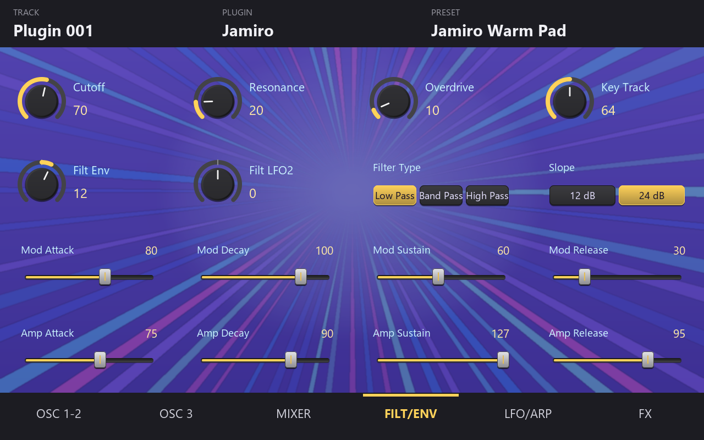

# Jamiro

A polyphonic synthesizer for Akai MPC standalone hardware (MPC One/One+, Live/Live II/Live III,
X/X SE, Key 37/61, XL, and Force) by **Yann**.

Jamiro recreates the synth engine built into the **Novation X-Station** keyboard: the "KS" engine
shared with the KS4, KS5, KS Rack and K-Station. It uses the same architecture and the same
0..127 / -64..+63 parameter values as the hardware, and it reads **X-Station / KS `.syx` patch
banks**. If you own the original banks (for example Novation's "100 New Sounds" update or the
Jamiroquai bank made for the X-Station), drop them in the plugin's `Content/Banks/` folder and
play your X-Station sounds on the MPC.

> Jamiro is an independent project. It is not affiliated with or endorsed by Novation, Focusrite
> or Jamiroquai. "Novation" and "X-Station" are trademarks of their owners. No Novation sounds,
> samples or firmware are included; all code is original (MIT licence).



*Preview of the FILT/ENV page, drawn from the plugin's skin files.*

## Features

- 8 voices, 3 oscillators per voice, plus noise and ring modulation (1×2). Unison up to 8 voices.
- Voice modes Mono, Mono AG (auto-glide on legato notes), Poly 1 and Poly 2; portamento.
- 17 waveforms: sine, triangle, saw (with "double saw"), variable pulse, 4 noise types, and 9
  additive tables (organ, harpsichord, e-piano, slap bass, Rhodes, tine, Wurly, Clavinet, analog
  bass). Their harmonic levels, the noise colours and the relative loudness of every waveform
  were measured on a real X-Station; the tables are resynthesised from those levels, not samples.
- Osc 1 > 2 hard sync, osc 2 > 3 FM with its own AD envelope, LFO / envelope level modulation.
- Filter: low-, band- or high-pass, 12 or 24 dB, overdrive, Q normalise, key tracking, envelope,
  LFO 2, velocity, mod wheel and aftertouch.
- Amp and mod envelopes (ADSR + velocity); 2 LFOs with the X-Station's 32 shapes (sine, triangle,
  saw, square, S/H, envelope curves, chromatic / major / major-7 scales, 9 patterns; measured on the
  hardware), delay, tempo sync, key sync with start phase, unipolar, one-shot, common (all voices)
  and velocity.
- Arpeggiator synced to the MPC tempo: Up, Down, Up-Down 1/2, Played, Random, Chord; 1-4 octaves;
  gate; latch.
- Effects: distortion, tilt EQ, chorus/phaser, stereo delay (tempo sync), reverb (6 sizes),
  pan and auto-pan.
- 6 touch-screen pages plus an LFO MENU sub-page (press the LFO/ARP key again), all controls on
  Q-Links. 7 original programs built in.

## Tested on

| Device | Generation | MPC OS | Version |
|---|---|---|---|
| MPC Key 37 | Gen 1 (32-bit, armv7) | 3.10.1 or later | 1.0.0 |

Hardware testing so far is a quick listening test on Gen 1: the plugin loads, the screen pages
show, and the presets play. Editing, automation, the arpeggiator and long sessions have not been
tested on hardware yet. Builds are also made for Gen 2 (aarch64) MPCs but have not been tried on
one. Reports from any MPC are very welcome (open an issue).

## Installing

Requires MPC OS 3.10.1 or later. Enable **Preferences → Enhancements (Beta) → Enable
Enhancements and External Plugin Support**.

Install it from the OpenMPC Plugin Manager, or copy the `Yann - VST - Jamiro` folder from the
release zip into a `VST2 Plugins` folder at the root of a drive (SD card, USB drive or internal disk).

### Loading X-Station banks

Copy your `.syx` files into the plugin's `Content/Banks/` folder:

```
VST2 Plugins/Yann - VST - Jamiro/Content/Banks/1 My Bank.syx
VST2 Plugins/Yann - VST - Jamiro/Content/Banks/2 Another Bank.syx
```

At start-up Jamiro converts every program it finds, in file-name order. The first file becomes
programs 100-199, the second 200-299, and so on. It reads X-Station bank and program dumps, and
KS4 / KS5 / KS Rack / K-Station program and program-pair dumps. The conversion follows Novation's
published program data layout. Envelope and depth curves are estimated, so patches sound close to
the hardware but not identical. LFO shapes, speed, phase and lock are read from the patch. Not
reproduced yet: arpeggiator rhythm patterns, delay ratio, EQ modulation.

## Building

Jamiro is a project for the MPC Plugin SDK. Put `plugins/Jamiro` inside the SDK's `plugins/`
folder, then:

```
python tools/build.py plugins/Jamiro
python tools/package.py plugins/Jamiro
```

After editing `ui.json`, run `python plugins/Jamiro/tools/make_skin.py` (it regenerates `skins/`
with the background image), then build again. `tools/make_captions.py` (needs Pillow) redraws the
switch-box caption images in `art/captions/` if you change the captions.

Releases are built by GitHub Actions with OpenMPC's release workflow (`.github/workflows/release.yml`).

## Contributing

Ideas, bug reports and pull requests are welcome, especially:
- more accurate X-Station curves (envelope times, LFO rates, filter response);
- arpeggiator rhythm patterns;
- new original programs (please do not commit third-party sound banks);
- CPU optimisation on 32-bit MPCs.

The source is commented: start with `plugins/Jamiro/src/Jamiro.cpp` (signal flow at the top),
`jamiro_dsp.h` (oscillators, LFOs, effects) and `ks_import.h` (the `.syx` reader).
A French README is in `plugins/Jamiro/README.md`.

## Changes

- **1.1.4**: low notes no longer buzz. The Overdrive is back at the filter input, as on the
  X-Station and in 1.0.6: from 1.0.7 to 1.1.3 it drove the filter output, which turned filtered
  basses into square waves with a steady fizz up to 10 kHz on deep notes, even with the filter
  closed (about 100 bank patches use it). Kept: 4x oversampling, smoothed knob, level
  compensation (fast at note start, slow afterwards so it cannot ripple on deep notes). New 5 Hz
  DC blocker at the output: narrow pulse waves carried a large DC offset (thumps at note start
  and end, lost headroom). Same parameters: banks and projects load unchanged.
- **1.1.3**: no more stuck notes in Mono and Mono AG. A key sent twice before its note-off (for
  example a looped sequence whose next note starts before the previous one ends) no longer leaves
  a voice held forever, and changing the voice mode or the unison while a key is down releases the
  held voices cleanly. Same parameters as before: banks and projects load unchanged.
- **1.1.2**: warmer Overdrive and Distortion. Both now run at 4x oversampling (no more metallic
  aliasing in the treble on heavy, electro and reese / DNB basses), their knobs are smoothed (no
  crackle when turning them) and the automatic level matching keeps the loudness the same from 0
  to 127. The Distortion is reworked like a bass pedal: same grit from the start to the end of a
  note, 20 % clean blend for body, a softer top and a tone low-pass against fizz. Same parameters
  as before: banks and projects load unchanged. Oversampling filters follow Laurent de Soras' HIIR
  method (WTFPL).
- **1.0.8**: the LFOs now have all 32 X-Station shapes, measured on a real X-Station (the 10
  existing shapes keep their place and were corrected: falling saw, triangle starting at the bottom,
  real decay / attack curves, true chromatic scale); new shapes include the envelope curves,
  Maj-Modes, Major-7 and Patterns 1-9. LFO speed recalibrated on the hardware. New LFO MENU
  sub-page (press LFO/ARP again): KeySync, Unipolar, One-Shot and Common as OFF / ON boxes, start
  Phase and Velocity for each LFO. X-Station banks now load their LFO shape, phase and lock.
- **1.0.7**: the 9 table waves rebuilt from measurements of a real X-Station (harmonic levels
  of each wave, static like the hardware), so they sound much more distinct; the HP / BP / HBP
  noises recoloured to match; every waveform now has the same loudness relative to the saw as on
  the hardware (triangle slightly louder). Overdrive now works after the filter with a steady
  level, Mix Level range reduced to +9 dB; preset levels rebalanced.
- **1.0.6**: distortion keeps a constant volume over its whole range (automatic level matching)
  with a more progressive drive; preset levels rebalanced.
- **1.0.5**: oscillator octave knobs now go from -3 to +3, centred on 0 (KS patches use -1..+2
  and keep their settings); rebuilt effects with the same controls: 3-voice stereo chorus,
  6-stage stereo phaser with deeper notches, tape-style delay (filtered, softly saturated repeats
  that never run away), denser reverb (8 combs + 4 allpasses per side, pre-delay per room size);
  preset levels rebalanced; built with the current OpenMPC release tools.
- **1.0.4**: screen design: switch boxes now show their captions in red (MONO / M.AG /
  POLY1 / POLY2, LP / BP / HP, 12 / 24 dB, CHORUS / PHASER), drawn into the button images so the
  MPC always shows them; menu controls (waves, sync, arp mode/rate...) are boxes with readable
  name and value text.
- **1.0.3**: unison no longer crackles (steady level, random start phases, stereo spread);
  transparent look-ahead output limiter (no distortion at high Mix Level / Volume); table waves
  now move from a bright attack to a rounder body (velocity sensitive); new filter with proper
  24 dB Butterworth slope and resonance that self-oscillates at maximum; overdrive keeps a steady
  level; analog-style envelopes with longer, more musical decay/release; finer mod wheel /
  aftertouch vibrato; red, short captions in the switch boxes (LP/BP/HP, 12/24 dB, voice mode).
- **1.0.2**: rebuilt the 9 table waveforms (Organ, Harpsichord, E.Piano, Slap Bass, Rhodes,
  Rhodes Tine, Wurly, Clavinet, Ana Bass) with richer spectra, one band-limited version per
  octave (no more sudden dulling above middle C) and matched loudness; preset levels rebalanced.
  Q-Links now bank by rows: on 4-knob MPCs the knobs, left to right, drive one row of the screen.
- **1.0.1**: neon light-beam skin background.
- **1.0.0**: first release.

## Licence

MIT, see `LICENSE`. The reverb uses the classic public-domain Freeverb comb/allpass tunings.
